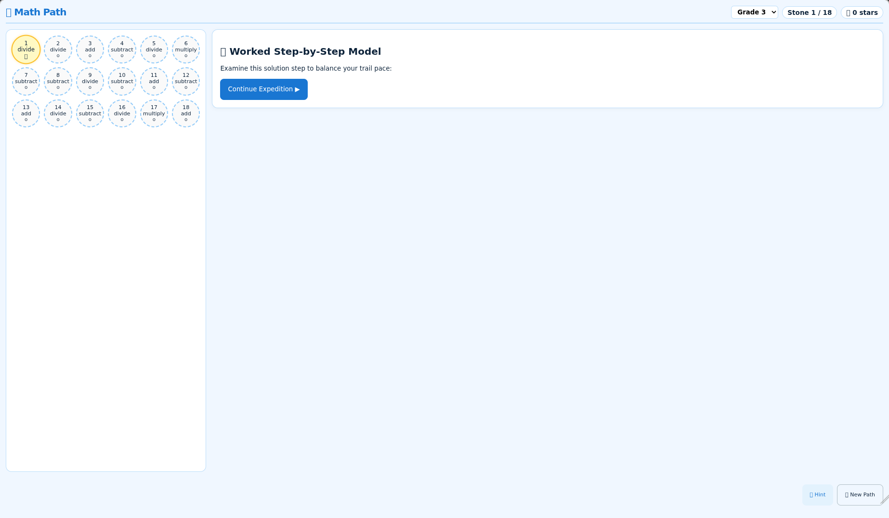

# Math Path

Step along the winding arithmetic stepping stone path with mental math, addition, subtraction, multiplication, and mixed operations.

[Phone view](docs/phone.png) · [Game rules](docs/CORE-RULES.md)

The release candidate opened from Games → Learning & Strategy. The browser check played a turn and closed the window on phone, 1080p and 4K layouts. These screenshots show synthetic gameplay.

Run the native suite in the WebOS npm workspace with `node --test tests/*.test.mjs` from this directory.
